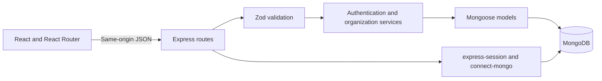
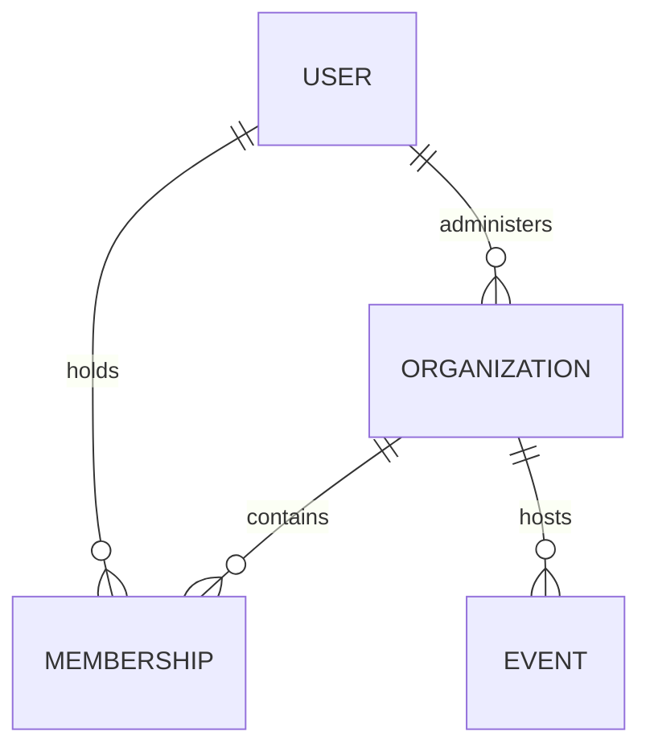

# ClubOS architecture

## Goal and boundaries

Prove the account → club → member workflow: an administrator creates a club, a second account joins, the administrator sees that member, and the member sees only their own membership. Another club remains inaccessible. Phase 2 extends this flow with received payments, renewals, capacity-limited events, manual attendance, and optional demo-inbox notifications.

## Architecture and state



Vite proxies `/api` during development. Production Express serves API routes, built assets, and the frontend route fallback. Startup waits for database connection and index creation; health checks return 503 when disconnected.

AuthContext owns the current user, session lookup, login/logout, profile updates, and session-expiration handling. ClubsContext owns accessible clubs and the selected club ID. Only that non-sensitive ID is stored in local storage. Passwords and session tokens are never stored there. Shared API/resource helpers normalize failures, cancel obsolete reads, and separate results by account and route.

The component hierarchy is `AuthProvider → ClubsProvider → App → WorkspaceLayout → page`. ClubBoundary verifies the selected club before mounting its pages. Forms, notices, loading/error states, avatars, membership badges, join-code copying, and member tables are reusable.

## Data relationships



| Model | Fields and constraints |
| --- | --- |
| User | Name, unique normalized email, password hash excluded from default queries, timestamps |
| Organization | Name, description, administrator reference, unique random 12-character join code, integer CAD fee in cents, term days, timestamps |
| Membership | Organization/user references, validity dates, embedded payment/renewal history, timestamps; unique `(organizationId, userId)` |
| Event | Organization/creator references, details, start time, capacity, embedded registrations and check-in timestamps |

Clubs have one paid plan, with positive fees up to CAD 10,000 and terms of 1–1095 days. Creation does not enroll the administrator as a paid member. Joining inserts a pending membership. Null expiration means pending; expiration later than now means active; expiration at or before now means expired. Timestamps use UTC; dates display in the browser's time zone.

Club creation and joining each require one document write. Database indexes prevent concurrent duplicate registrations and joins. Payments and validity changes share one membership document. Registrations and attendance share one event document. These additive fields default to empty arrays for existing records; startup does not reset data.

## API and authorization

| Method and route | Behavior |
| --- | --- |
| `POST /api/auth/register` | Create account/session using name, email, password |
| `POST /api/auth/login` | Authenticate and rotate session ID |
| `POST /api/auth/logout` | Destroy session and clear cookie |
| `GET /api/auth/me`, `GET /api/me` | Return own profile |
| `PATCH /api/me` | Update own name; reject email/role changes |
| `GET /api/organizations` | List only owned/joined clubs |
| `POST /api/organizations` | Create club using name, description, feeCents, termDays |
| `POST /api/organizations/join` | Join with joinCode |
| `GET /api/organizations/:orgId` | Return authorized club; join code only for administrator |
| `GET /api/organizations/:orgId/memberships/me` | Own membership; null for un-enrolled administrator |
| `GET /api/organizations/:orgId/memberships` | Administrator-only search/status/page/limit listing |
| `GET /api/organizations/:orgId/dashboard` | Administrator-only total/active/expired/pending counts |
| `GET /api/health` | Database readiness |
| `GET /api/config` | Public notification mode only; no secrets or recipient address |
| `GET /api/organizations/:orgId/memberships/:membershipId` | Administrator member details and payment history |
| `POST /api/organizations/:orgId/memberships/:membershipId/payments` | Administrator records a received full-fee payment with request ID |
| `GET/POST /api/organizations/:orgId/events` | Authorized paginated listing / administrator creation |
| `GET /api/organizations/:orgId/events/:eventId` | Authorized event details |
| `GET /api/organizations/:orgId/events/:eventId/participants` | Administrator participant list |
| `POST/DELETE /api/organizations/:orgId/events/:eventId/registrations/me` | Active-member registration / own cancellation |
| `POST /api/organizations/:orgId/events/:eventId/attendance/:membershipId` | Administrator idempotent check-in |

Every scoped read checks organization ownership/membership on the server. Unrelated accounts receive 404; known members requesting administrator information receive 403. Owning one club grants no privileges in another. Member responses exclude other members' records and join codes.

Success responses use named objects: `{ user }`, `{ organization }`, `{ membership }`, `{ memberships, pagination }`, or `{ counts }`. Errors use `{ error: { code, message, fields? } }`. Strict body schemas reject unknown privileged fields. Search text is escaped before use in regular expressions.

Sessions live in MongoDB for seven days. Cookies are HttpOnly, SameSite=Lax, and Secure in production. Authentication regenerates and explicitly saves the session before responding. Production trusts the single Render reverse-proxy hop. Unsafe API requests require the configured Origin and JSON content. Authentication is limited to 20 attempts per IP per 15 minutes. Helmet supplies browser security headers; API responses are not cached. Passwords use bcrypt with both character and UTF-8 byte limits validated.

## Screen wireframes

```text
SIGN IN / REGISTER
┌──────────────────────────┬───────────────────────────┐
│ ClubOS                   │ Sign in / Create account  │
│ Community introduction   │ Name (registration only)  │
│ Decorative illustration  │ Email / Password          │
│                          │ Submit / error feedback   │
└──────────────────────────┴───────────────────────────┘

CLUB WORKSPACE
┌──────────────┬───────────────────────────────────────┐
│ Club switch  │ Page heading / context                │
│ Your clubs   │ Overview: real counts / join code     │
│ Overview     │ Members: search / status / table      │
│ Members OR   │ Member: own membership / status       │
│ Membership   │ Account: editable name                │
│ My account   │                                       │
│ Sign out     │                                       │
└──────────────┴───────────────────────────────────────┘
```

The Your Clubs page lists accessible clubs and provides creation/join forms. Mobile navigation uses a labeled menu; cards stack and tables scroll inside their container. Inputs have labels, errors remain visible, focus is visible, and reduced-motion preferences are respected. There are no fake operational statistics or inactive feature links.


## Phase 2 consistency and delivery

Payment requests contain a UUID, amount, method, optional reference, and payment date. The amount must match the club's full fee. A payment updates membership dates and appends history together under Mongoose optimistic concurrency. Repeating the same UUID and payload returns the saved result; reusing it for different input returns a conflict. Concurrent distinct renewals conflict rather than silently overwriting each other. Validity starts from the later of recording time and the current expiration. A backdated paid-at date is retained as receipt metadata; future payment dates are rejected.

Registration requires current active membership and an upcoming event. One conditional MongoDB update checks the capacity and absence of that member before inserting a registration. Cancellation and check-in use conditional atomic updates; checked-in registrations cannot be cancelled. Repeated check-in preserves the first timestamp. Administrator participant responses contain identities; member event responses expose only counts and their own registration.

Dashboard aggregates are scoped by organization. They include confirmed payment totals, pending initial fees, active memberships expiring within 30 days, event registrations, and attendance. Pending initial fees do not assume expired members owe a renewal.

Notification services run after persistence and send plain-text HTTPS requests to Resend with a five-second timeout. The server overrides recipients with the configured demo inbox and uses persisted action identifiers as provider idempotency keys. Failure is returned as a separate delivery notice. Public configuration exposes only demo/disabled mode. Background queues, automatic retries, and delivery tracking are deferred.

Phase 2 screens add member detail/payment forms, personal history, event creation/browsing/details, participant check-in, dashboard summaries, and notification notices. Browser QA covers both administrator and member roles on desktop and mobile in Chrome and Firefox using disposable data and separate QA ports.


## Administrator fee changes

`PATCH /api/organizations/:orgId` accepts only `{ feeCents, expectedFeeCents }` from the club administrator. Both are positive integer CAD cents up to 1,000,000. A conditional organization update rejects stale settings with 409. Other members receive 403 and unrelated accounts receive 404. Updating the fee never changes existing membership validity or historical payments. Subsequent new payment requests use the club fee read for that request; retrying an already-saved request still returns its original result even after a fee change. Administrators edit the fee under Club settings. Successful saves update shared club state immediately; stale edits offer a refresh action. Member routes redirect away from settings.


## Version 1 dashboard analytics

The administrator-only dashboard response includes twelve zero-filled calendar months in `America/Toronto`: recorded joins, cumulative membership records (including the pre-window baseline), actual check-in timestamps, and payments grouped by received date. These are joined-record totals rather than a reconstruction of historical active status. Current membership status still derives from expiration at request time. Upcoming events are the next four future events with registration counts/capacity; participant identities are omitted. All facets begin with the same organization filter. The administrator UI renders the response as membership status, membership growth, attendance/payment trends, and upcoming-event capacity. Six/twelve-month selection uses the same fetched data. SVG point readouts are keyboard accessible and monthly tables provide a textual representation.


## Membership card snapshots

`GET /api/organizations/:orgId/memberships/me/card` requires an authenticated club member and reads only that user's membership. It returns `{ card, membership }` with the current profile name, club name, membership ID, validity dates, current status, and issue time. The refreshed membership includes its existing payment history for the page; the card DTO excludes email, join codes, and payment information. Unpaid memberships receive 409 until activated; expired memberships retain their real dates and expired status. Administrators without a membership receive 404. Responses inherit API `Cache-Control: no-store`.

The next client checkpoint will use this snapshot to produce a downloadable proof card. Cards will be static records of issuance; saving after renewal will fetch current dates.
