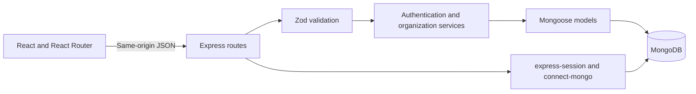
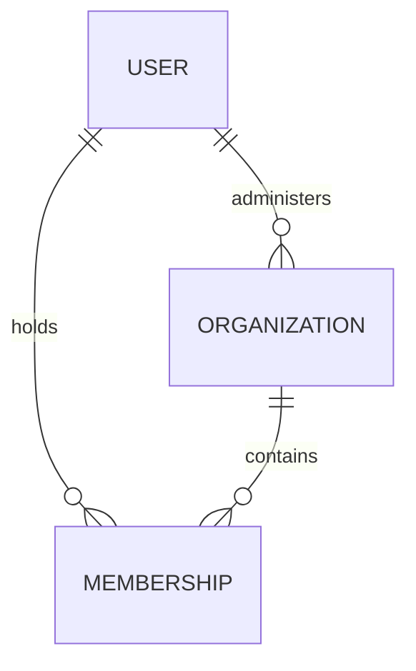

# Foundation design

## Goal and boundaries

Prove the account → club → member workflow: an administrator creates a club, a second account joins, the administrator sees that member, and the member sees only their own membership. Another club remains inaccessible. Payments, events, attendance, and notifications belong to phase 2.

## Architecture and state



Vite proxies `/api` during development. Production Express serves API routes, built assets, and the frontend route fallback. Startup waits for database connection and index creation; health checks return 503 when disconnected.

AuthContext owns the current user, session lookup, login/logout, profile updates, and session-expiration handling. ClubsContext owns accessible clubs and the selected club ID. Only that non-sensitive ID is stored in local storage. Passwords and session tokens are never stored there. Shared API/resource helpers normalize failures, cancel obsolete reads, and separate results by account and route.

The component hierarchy is `AuthProvider → ClubsProvider → App → WorkspaceLayout → page`. ClubBoundary verifies the selected club before mounting its pages. Forms, notices, loading/error states, avatars, membership badges, join-code copying, and member tables are reusable.

## Data relationships



| Model | Fields and constraints |
| --- | --- |
| User | Name, unique normalized email, password hash excluded from default queries, timestamps |
| Organization | Name, description, administrator reference, unique random 12-character join code, integer CAD fee in cents, term days, timestamps |
| Membership | Organization/user references, validity dates, timestamps; unique `(organizationId, userId)` |

Clubs have one paid plan, with positive fees up to CAD 10,000 and terms of 1–1095 days. Creation does not enroll the administrator as a paid member. Joining inserts a pending membership. Null expiration means pending; expiration later than now means active; expiration at or before now means expired. Timestamps use UTC; dates display in the browser's time zone.

Club creation and joining each require one document write. Database indexes prevent concurrent duplicate registrations and joins. Phase 2 will embed immutable payment/renewal entries in memberships and registrations/attendance in events; Foundation introduces no unused event/payment endpoints.

## API and authorization

| Method and route | Behavior |
| --- | --- |
| `POST /api/auth/register` | Create account/session using name, email, password |
| `POST /api/auth/login` | Authenticate and rotate session ID |
| `POST /api/auth/logout` | Destroy session and clear cookie |
| `GET /api/auth/me`, `GET /api/me` | Return own profile |
| `PATCH /api/me` | Update own name; reject email/role changes |
| `GET /api/organizations` | List only owned/joined clubs |
| `POST /api/organizations` | Create club using name, description, feeCents, termDays |
| `POST /api/organizations/join` | Join with joinCode |
| `GET /api/organizations/:orgId` | Return authorized club; join code only for administrator |
| `GET /api/organizations/:orgId/memberships/me` | Own membership; null for un-enrolled administrator |
| `GET /api/organizations/:orgId/memberships` | Administrator-only search/status/page/limit listing |
| `GET /api/organizations/:orgId/dashboard` | Administrator-only total/active/expired/pending counts |
| `GET /api/health` | Database readiness |

Every scoped read checks organization ownership/membership on the server. Unrelated accounts receive 404; known members requesting administrator information receive 403. Owning one club grants no privileges in another. Member responses exclude other members' records and join codes.

Success responses use named objects: `{ user }`, `{ organization }`, `{ membership }`, `{ memberships, pagination }`, or `{ counts }`. Errors use `{ error: { code, message, fields? } }`. Strict body schemas reject unknown privileged fields. Search text is escaped before use in regular expressions.

Sessions live in MongoDB for seven days. Cookies are HttpOnly, SameSite=Lax, and Secure in production. Authentication regenerates and explicitly saves the session before responding. Production trusts the single Render reverse-proxy hop. Unsafe API requests require the configured Origin and JSON content. Authentication is limited to 20 attempts per IP per 15 minutes. Helmet supplies browser security headers; API responses are not cached. Passwords use bcrypt with both character and UTF-8 byte limits validated.

## Screen wireframes

```text
SIGN IN / REGISTER
┌──────────────────────────┬───────────────────────────┐
│ ClubOS                   │ Sign in / Create account  │
│ Community introduction   │ Name (registration only)  │
│ Decorative illustration  │ Email / Password          │
│                          │ Submit / error feedback   │
└──────────────────────────┴───────────────────────────┘

CLUB WORKSPACE
┌──────────────┬───────────────────────────────────────┐
│ Club switch  │ Page heading / context                │
│ Your clubs   │ Overview: real counts / join code     │
│ Overview     │ Members: search / status / table      │
│ Members OR   │ Member: own membership / status       │
│ Membership   │ Account: editable name                │
│ My account   │                                       │
│ Sign out     │                                       │
└──────────────┴───────────────────────────────────────┘
```

The Your Clubs page lists accessible clubs and provides creation/join forms. Mobile navigation uses a labeled menu; cards stack and tables scroll inside their container. Inputs have labels, errors remain visible, focus is visible, and reduced-motion preferences are respected. There are no fake operational statistics or inactive feature links.
