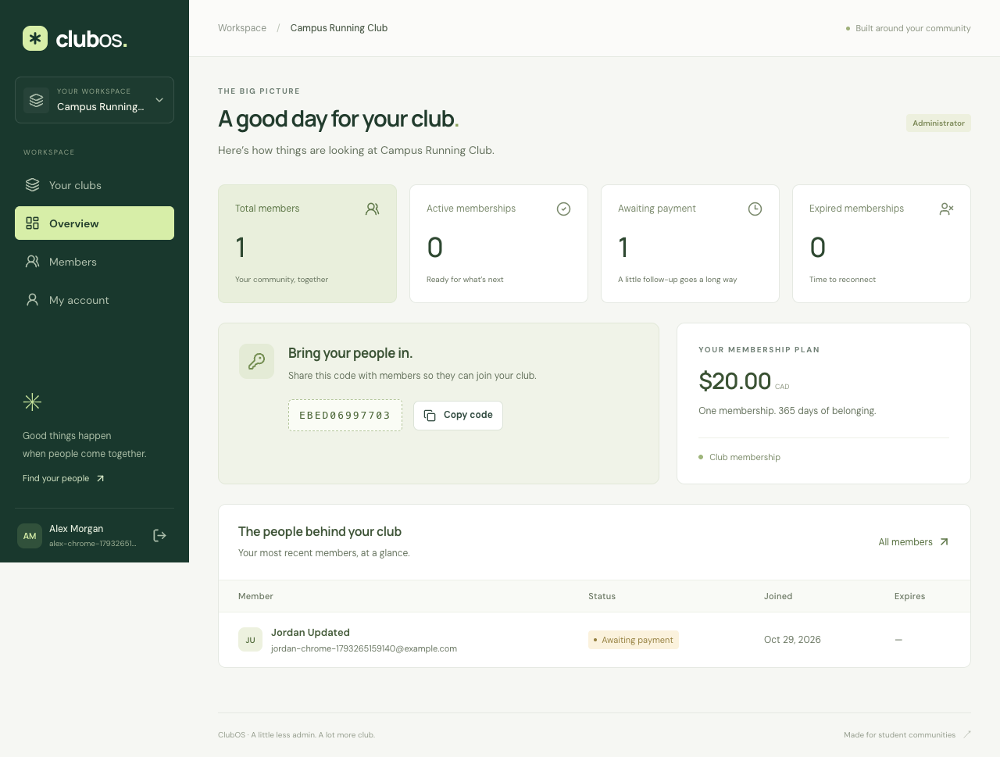
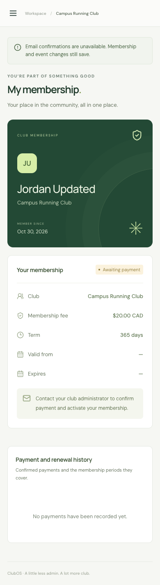

# ClubOS development log

## Week of October 26, 2026

### October 29 — Foundation checkpoints

The existing uncommitted implementation is being organized into independently checked commits. These checkpoints describe actual work in this session, not separate invented evenings.

- **Checkpoint 1:** Foundation architecture, data relationships, role boundaries, and screen wireframes.
- **Checkpoint 2:** React/Express workspaces, Node 24 configuration, local setup, MongoDB connectivity, and health checks.
- **Checkpoint 4:** Secure account/profile APIs, password hashing, persistent sessions, and authentication safeguards with tests.
- **Checkpoint 5:** Club creation, joining by code, concurrent duplicate protection, and organization isolation with tests.
- **Checkpoint 6:** Own-membership views, administrator member search/filtering/pagination, and dashboard counts with tests.
- **Checkpoint 8:** Account registration/login, protected routes, profile editing, reusable controls, and component tests.
- **Checkpoint 9:** Club creation/joining screens, accessible club selection, and workspace navigation.
- **Checkpoint 10:** Administrator dashboards, join-code copying, member management, and responsive personal membership views.
- **Checkpoint 11:** Chrome/Firefox acceptance workflow, disposable browser QA database, and desktop/mobile screenshots.
- **Checkpoint 12:** GitHub Actions checks, Render configuration, production frontend serving, and deployment instructions.

**Verification:** each code checkpoint is checked from the isolated history checkout using only its committed feature set. Checks and test counts are recorded in the commit messages.

**Results:** lint, TypeScript, component/API tests, production compilation, and the complete Chrome/Firefox workflow passed. The compiled-server smoke test verifies database health, direct application links, built assets, and API 404 responses.

**Challenges and solutions:** progressive route wiring prevents missing future imports; unique indexes protect simultaneous joins; database-backed sessions survive application restarts; awaiting session-store initialization prevents TTL-index cleanup races. Browser checks run after builds to avoid Vite reload interference.

**Learning:** tenant authorization must scope both queries and serialized responses.

```ts
membershipSchema.index({ organizationId: 1, userId: 1 }, { unique: true });
```





**Weekly summary:** Foundation establishes account → club → member workflows with verified access boundaries. Release history now contains setup, backend, and complete Foundation milestones. Live hosting remains pending Render/Atlas account setup.


### October 30, 2026 — Club workflows

Changes were implemented and verified in focused commits:

- Manual payment APIs activate and renew memberships, preserve payment history, and prevent duplicate or concurrent payment submissions using request IDs and optimistic concurrency.
- Administrators can record verified payments from member details, while members can view their own payment and renewal history. Payment forms retain request IDs across retries and membership dates update after confirmation.
- Club administrators can create events and view participants; active members can register or cancel. Atomic event updates enforce capacity and prevent duplicate registrations while participant identities stay restricted to administrators.
- Responsive event screens support event creation, paginated browsing, membership-aware registration, cancellation, and administrator participant lists with loading and failure states.

Each code commit passes lint, TypeScript, unit/API tests, builds, and compiled-server smoke checks before it is committed. Provider delivery is tested with mocks; actual email requires the configured Resend API key and demo inbox.
