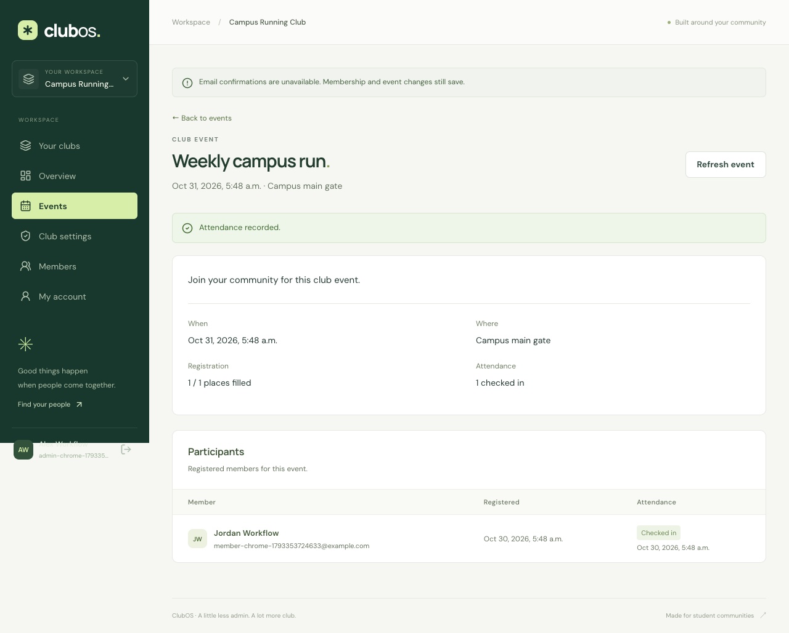
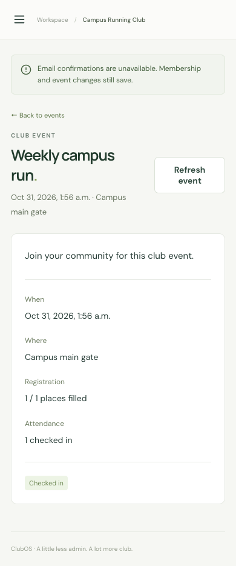
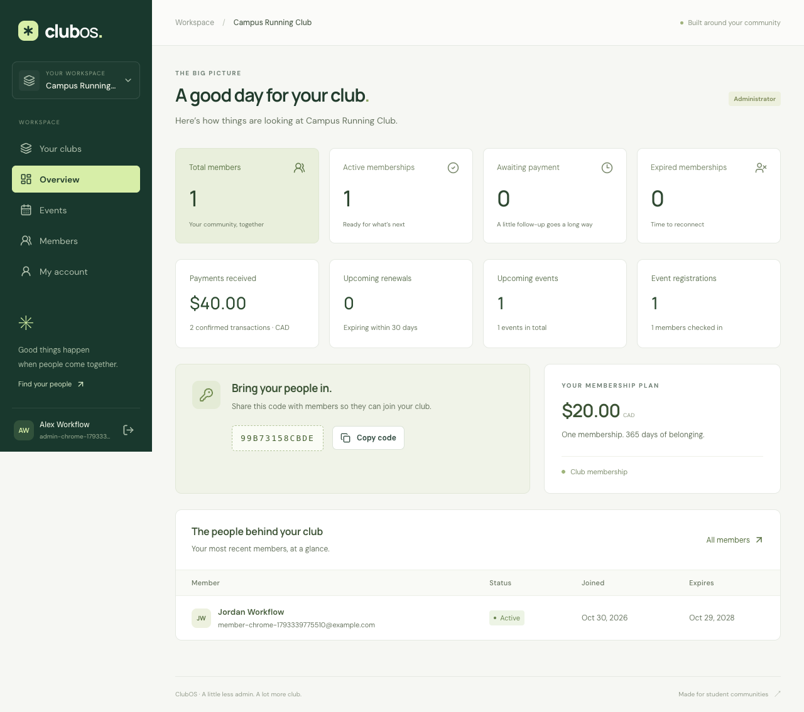
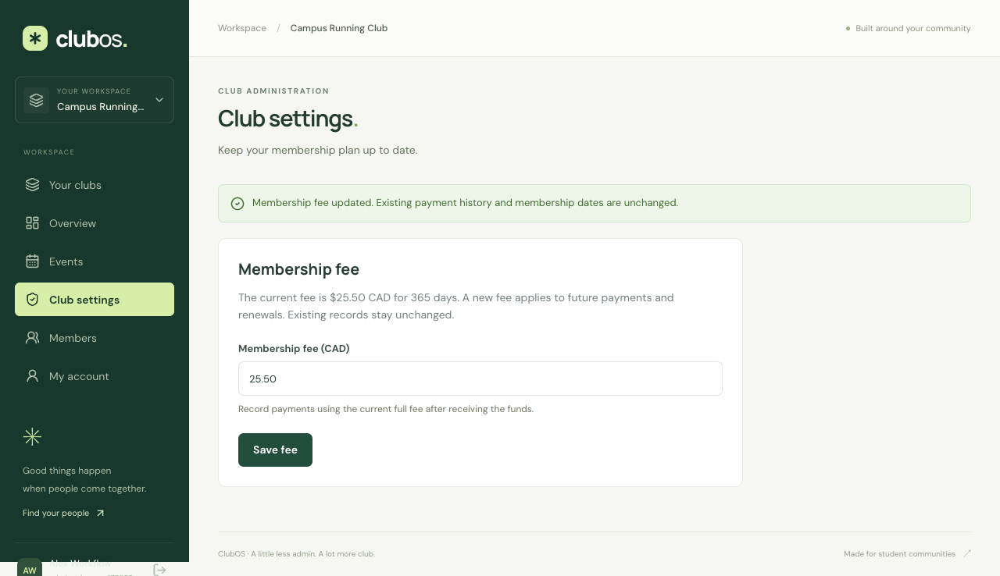
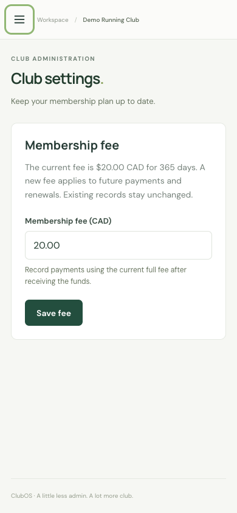

# ClubOS development log

## Week of October 26, 2026

### October 29 — Foundation checkpoints

The existing uncommitted implementation is being organized into independently checked commits. These checkpoints describe actual work in this session, not separate invented evenings.

- **Checkpoint 1:** Foundation architecture, data relationships, role boundaries, and screen wireframes.
- **Checkpoint 2:** React/Express workspaces, Node 24 configuration, local setup, MongoDB connectivity, and health checks.
- **Checkpoint 4:** Secure account/profile APIs, password hashing, persistent sessions, and authentication safeguards with tests.
- **Checkpoint 5:** Club creation, joining by code, concurrent duplicate protection, and organization isolation with tests.
- **Checkpoint 6:** Own-membership views, administrator member search/filtering/pagination, and dashboard counts with tests.
- **Checkpoint 8:** Account registration/login, protected routes, profile editing, reusable controls, and component tests.
- **Checkpoint 9:** Club creation/joining screens, accessible club selection, and workspace navigation.
- **Checkpoint 10:** Administrator dashboards, join-code copying, member management, and responsive personal membership views.
- **Checkpoint 11:** Chrome/Firefox acceptance workflow, disposable browser QA database, and desktop/mobile screenshots.
- **Checkpoint 12:** GitHub Actions checks, Render configuration, production frontend serving, and deployment instructions.

**Verification:** each code checkpoint is checked from the isolated history checkout using only its committed feature set. Checks and test counts are recorded in the commit messages.

**Results:** lint, TypeScript, component/API tests, production compilation, and the complete Chrome/Firefox workflow passed. The compiled-server smoke test verifies database health, direct application links, built assets, and API 404 responses.

**Challenges and solutions:** progressive route wiring prevents missing future imports; unique indexes protect simultaneous joins; database-backed sessions survive application restarts; awaiting session-store initialization prevents TTL-index cleanup races. Browser checks run after builds to avoid Vite reload interference.

**Learning:** tenant authorization must scope both queries and serialized responses.

```ts
membershipSchema.index({ organizationId: 1, userId: 1 }, { unique: true });
```


**Weekly summary:** Foundation establishes account → club → member workflows with verified access boundaries. Release history now contains setup, backend, and complete Foundation milestones. Live hosting remains pending Render/Atlas account setup.


### October 30, 2026 — Club workflows

Changes were implemented and verified in focused commits:

- Manual payment APIs activate and renew memberships, preserve payment history, and prevent duplicate or concurrent payment submissions using request IDs and optimistic concurrency.
- Administrators can record verified payments from member details, while members can view their own payment and renewal history. Payment forms retain request IDs across retries and membership dates update after confirmation.
- Club administrators can create events and view participants; active members can register or cancel. Atomic event updates enforce capacity and prevent duplicate registrations while participant identities stay restricted to administrators.
- Responsive event screens support event creation, paginated browsing, membership-aware registration, cancellation, and administrator participant lists with loading and failure states.
- Administrators can check in registered participants from event details. Check-in retries preserve the original timestamp, and atomic updates keep cancellation and attendance consistent under concurrent requests.
- Administrator dashboards show confirmed payment totals, initial fees awaiting confirmation, renewals due within 30 days, upcoming events, registrations, and attendance. Aggregations remain scoped to the selected club.
- Membership payments and event registrations send Resend HTTPS confirmations to the configured demo inbox after persistence. Timeouts and provider failures return clear notices without rolling back records, duplicate payments do not resend, and public configuration exposes no credentials.
- Chrome and Firefox acceptance tests verify payment, renewal, registration, cancellation, attendance, and dashboard workflows on desktop and mobile. Isolated QA ports, screenshots, usage instructions, deployment notes, and the dated devlog document the completed behavior.

Each code commit passes lint, TypeScript, unit/API tests, builds, and compiled-server smoke checks before it is committed. Provider delivery is tested with mocks; actual email requires the configured Resend API key and demo inbox.

**Browser verification:** Foundation and full club-workflow scenarios passed in installed Chrome and Firefox (four scenarios), including desktop/mobile layouts, payment, renewal, cancellation, registration, check-in, and dashboard totals. QA uses disposable data on ports 3100/5174.

**Challenges and solutions:** conditional event writes prevent last-seat races; request IDs and optimistic concurrency prevent duplicate renewals; cancellation and check-in predicates preserve attendance under competing requests. Delivery failures remain separate from persisted business operations.

**Learning:** keep notification side effects outside the successful database operation and test races as invariants, rather than relying only on sequential UI behavior.

```ts
const periodStart = Math.max(now.getTime(), membership.expiresAt?.getTime() ?? 0);
```







**Weekly update:** Foundation now supports the administrator/member club workflow through manual payments, renewals, events, and attendance. Unit/API checks and Chrome/Firefox acceptance pass; real email delivery and live hosting remain pending credentials and account setup.


### October 30, 2026 — Validation and submission

These checkpoints record this session; deployment and real inbox delivery remain separate acceptance checks.

- **Checkpoint 1:** Administrators can update club fees through a validated API with stale-update protection. Existing payment history and membership dates are preserved; tests cover changed-fee renewals, saved-request retries, permissions, invalid input, and competing updates.

- **Checkpoint 2:** Administrator club settings provide fee editing in CAD, immediate shared-state updates, retained inputs on errors, and refresh controls for stale edits. Member access redirects safely, component tests cover saves and conflicts, and workspace versions align at v0.5.0.

- **Checkpoint 3:** An explicit demo seed command creates fictional administrator/member accounts, membership states, payment history, events, and attendance in a dedicated database. Reruns preserve edited records and passwords, reserved-address collisions fail safely, and no startup seed or email side effects are introduced.

- **Checkpoint 4:** The existing local-origin fix is now committed with regression tests and setup documentation. Development permits localhost and 127.0.0.1 only at the configured scheme and port; production and non-local origins retain exact matching.

- **Checkpoint 5:** Six Chrome/Firefox scenarios pass across desktop and mobile, including changed-fee renewals, seeded access, keyboard menu containment/Escape, failure recovery, and member restrictions. Mobile focus, dashboard labels, and seed timestamp preservation are corrected; CI runs browser acceptance with reports/traces, refreshed screenshots, and validation evidence.

- **Checkpoint 6:** Compiled production smoke checks cover secure sessions, fee changes, payments/renewals, organization isolation, registration/cancellation, repeated attendance, dashboard totals, and logout with scoped cleanup. Read-only live readiness and explicit live browser commands are documented; public hosting and actual inbox delivery remain pending connected accounts.


#### Weekly update — October 30

**Progress:** administrator fee settings, explicit fictional demo data, browser keyboard/error-recovery checks, CI browser artifacts, production workflow smoke tests, and submission documentation now complement the Foundation and club workflows. Verification passed 59 component/API tests, production builds/smoke, and six scenarios in installed Chrome/Firefox. The public repository was verified public. Live hosting and actual inbox delivery are pending connected Render/Atlas accounts and Resend configuration.

**Challenges and solutions:** a stale fee form could overwrite a newer price, so a conditional update compares the observed fee. New payments use the current price while saved-payment retries still return their original record. Mobile navigation now contains keyboard focus and closes with Escape, restoring the opener. Seed reruns use insert-only timestamps to avoid altering existing records. Browser captures wait for the menu transition to finish, and production smoke cleanup targets only its own fictional records.

**Learning:** validation should cover a feature across state changes: fee editing affects future renewals without changing prior payments. UI focus and delivery notices also need verification alongside database invariants. A locally verified build does not prove live hosting or real inbox delivery.

```ts
const updated = await Organization.findOneAndUpdate(
  { _id: organization._id, adminUserId: userId, feeCents: input.expectedFeeCents },
  { $set: { feeCents: input.feeCents } },
  { new: true, runValidators: true },
);
```





**Submission state:** README sections, demo walkthrough, validation evidence, and release notes are ready for review. The live application link, production browser results, and real membership/event confirmation receipts must be added after connected-account deployment; they are not recorded as completed.

- **Checkpoint 7:** The submission guide links required deliverables, records the five-minute administrator/member and fee-change walkthrough, and separates verified local evidence from pending hosting/inbox acceptance. README setup/usage, fictional-account instructions, example seed settings, screenshots, and the truthful weekly devlog are complete; local documentation links are validated.
