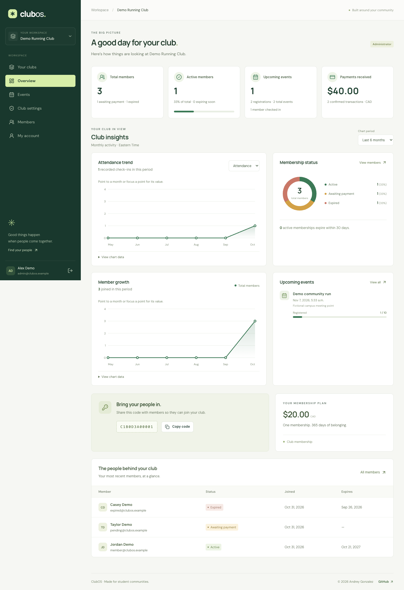
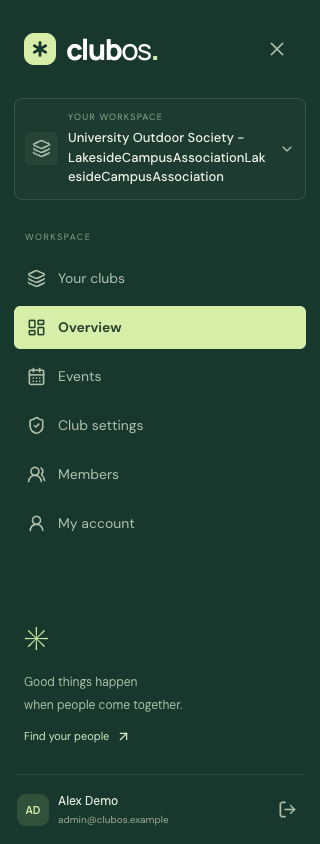
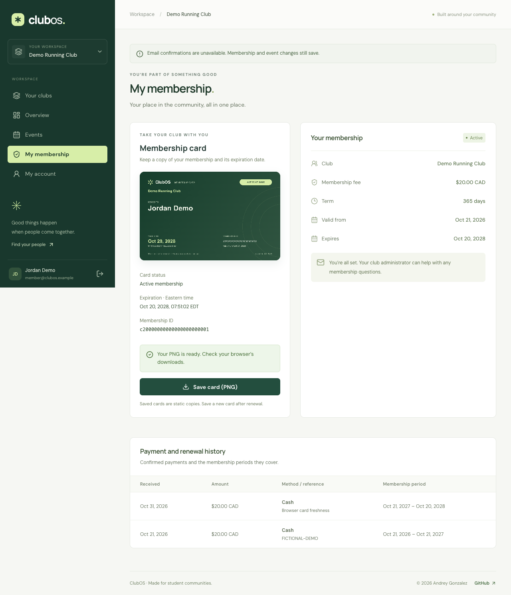
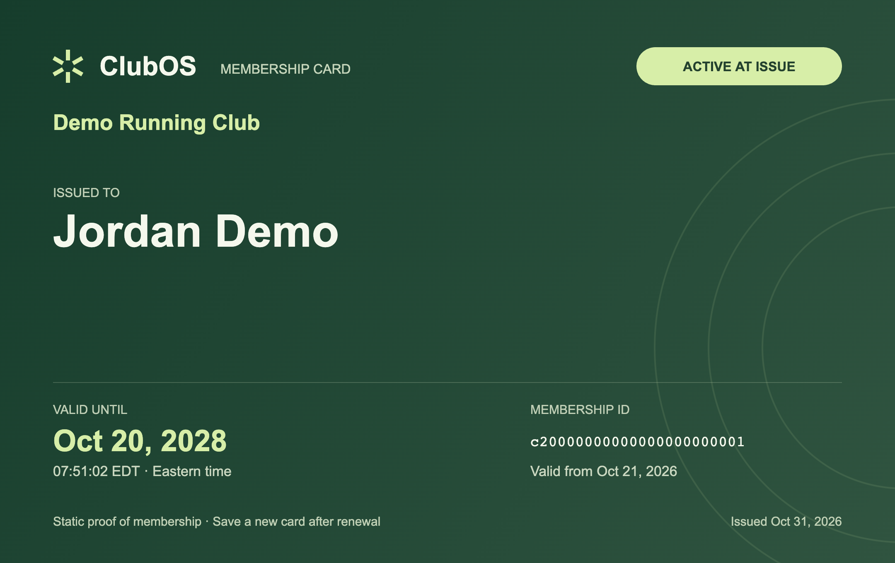

# ClubOS development log

## Week of October 26, 2026

### October 29 — Foundation checkpoints

The existing uncommitted implementation is being organized into independently checked commits. These checkpoints describe actual work in this session, not separate invented evenings.

- **Checkpoint 1:** Foundation architecture, data relationships, role boundaries, and screen wireframes.
- **Checkpoint 2:** React/Express workspaces, Node 24 configuration, local setup, MongoDB connectivity, and health checks.
- **Checkpoint 4:** Secure account/profile APIs, password hashing, persistent sessions, and authentication safeguards with tests.
- **Checkpoint 5:** Club creation, joining by code, concurrent duplicate protection, and organization isolation with tests.
- **Checkpoint 6:** Own-membership views, administrator member search/filtering/pagination, and dashboard counts with tests.
- **Checkpoint 8:** Account registration/login, protected routes, profile editing, reusable controls, and component tests.
- **Checkpoint 9:** Club creation/joining screens, accessible club selection, and workspace navigation.
- **Checkpoint 10:** Administrator dashboards, join-code copying, member management, and responsive personal membership views.
- **Checkpoint 11:** Chrome/Firefox acceptance workflow, disposable browser QA database, and desktop/mobile screenshots.
- **Checkpoint 12:** GitHub Actions checks, Render configuration, production frontend serving, and deployment instructions.

**Verification:** each code checkpoint is checked from the isolated history checkout using only its committed feature set. Checks and test counts are recorded in the commit messages.

**Results:** lint, TypeScript, component/API tests, production compilation, and the complete Chrome/Firefox workflow passed. The compiled-server smoke test verifies database health, direct application links, built assets, and API 404 responses.

**Challenges and solutions:** progressive route wiring prevents missing future imports; unique indexes protect simultaneous joins; database-backed sessions survive application restarts; awaiting session-store initialization prevents TTL-index cleanup races. Browser checks run after builds to avoid Vite reload interference.

**Learning:** tenant authorization must scope both queries and serialized responses.

```ts
membershipSchema.index({ organizationId: 1, userId: 1 }, { unique: true });
```


**Weekly summary:** Foundation establishes account → club → member workflows with verified access boundaries. Release history now contains setup, backend, and complete Foundation milestones. Live hosting remains pending Render/Atlas account setup.


### October 30, 2026 — Club workflows

Changes were implemented and verified in focused commits:

- Manual payment APIs activate and renew memberships, preserve payment history, and prevent duplicate or concurrent payment submissions using request IDs and optimistic concurrency.
- Administrators can record verified payments from member details, while members can view their own payment and renewal history. Payment forms retain request IDs across retries and membership dates update after confirmation.
- Club administrators can create events and view participants; active members can register or cancel. Atomic event updates enforce capacity and prevent duplicate registrations while participant identities stay restricted to administrators.
- Responsive event screens support event creation, paginated browsing, membership-aware registration, cancellation, and administrator participant lists with loading and failure states.
- Administrators can check in registered participants from event details. Check-in retries preserve the original timestamp, and atomic updates keep cancellation and attendance consistent under concurrent requests.
- Administrator dashboards show confirmed payment totals, initial fees awaiting confirmation, renewals due within 30 days, upcoming events, registrations, and attendance. Aggregations remain scoped to the selected club.
- Membership payments and event registrations send Resend HTTPS confirmations to the configured demo inbox after persistence. Timeouts and provider failures return clear notices without rolling back records, duplicate payments do not resend, and public configuration exposes no credentials.
- Chrome and Firefox acceptance tests verify payment, renewal, registration, cancellation, attendance, and dashboard workflows on desktop and mobile. Isolated QA ports, screenshots, usage instructions, deployment notes, and the dated devlog document the completed behavior.

Each code commit passes lint, TypeScript, unit/API tests, builds, and compiled-server smoke checks before it is committed. Provider delivery is tested with mocks; actual email requires the configured Resend API key and demo inbox.

**Browser verification:** Foundation and full club-workflow scenarios passed in installed Chrome and Firefox (four scenarios), including desktop/mobile layouts, payment, renewal, cancellation, registration, check-in, and dashboard totals. QA uses disposable data on ports 3100/5174.

**Challenges and solutions:** conditional event writes prevent last-seat races; request IDs and optimistic concurrency prevent duplicate renewals; cancellation and check-in predicates preserve attendance under competing requests. Delivery failures remain separate from persisted business operations.

**Learning:** keep notification side effects outside the successful database operation and test races as invariants, rather than relying only on sequential UI behavior.

```ts
const periodStart = Math.max(now.getTime(), membership.expiresAt?.getTime() ?? 0);
```


**Weekly update:** Foundation now supports the administrator/member club workflow through manual payments, renewals, events, and attendance. Unit/API checks and Chrome/Firefox acceptance pass; real email delivery and live hosting remain pending credentials and account setup.


### October 30, 2026 — Validation and submission

These checkpoints record this session; deployment and real inbox delivery remain separate acceptance checks.

- **Checkpoint 1:** Administrators can update club fees through a validated API with stale-update protection. Existing payment history and membership dates are preserved; tests cover changed-fee renewals, saved-request retries, permissions, invalid input, and competing updates.

- **Checkpoint 2:** Administrator club settings provide fee editing in CAD, immediate shared-state updates, retained inputs on errors, and refresh controls for stale edits. Member access redirects safely, component tests cover saves and conflicts, and workspace versions align at v0.5.0.

- **Checkpoint 3:** An explicit demo seed command creates fictional administrator/member accounts, membership states, payment history, events, and attendance in a dedicated database. Reruns preserve edited records and passwords, reserved-address collisions fail safely, and no startup seed or email side effects are introduced.

- **Checkpoint 4:** The existing local-origin fix is now committed with regression tests and setup documentation. Development permits localhost and 127.0.0.1 only at the configured scheme and port; production and non-local origins retain exact matching.

- **Checkpoint 5:** Six Chrome/Firefox scenarios pass across desktop and mobile, including changed-fee renewals, seeded access, keyboard menu containment/Escape, failure recovery, and member restrictions. Mobile focus, dashboard labels, and seed timestamp preservation are corrected; CI runs browser acceptance with reports/traces, refreshed screenshots, and validation evidence.

- **Checkpoint 6:** Compiled production smoke checks cover secure sessions, fee changes, payments/renewals, organization isolation, registration/cancellation, repeated attendance, dashboard totals, and logout with scoped cleanup. Read-only live readiness and explicit live browser commands are documented; public hosting and actual inbox delivery remain pending connected accounts.


#### Weekly update — October 30

**Progress:** administrator fee settings, explicit fictional demo data, browser keyboard/error-recovery checks, CI browser artifacts, production workflow smoke tests, and submission documentation now complement the Foundation and club workflows. Verification passed 59 component/API tests, production builds/smoke, and six scenarios in installed Chrome/Firefox. The public repository was verified public. Live hosting and actual inbox delivery are pending connected Render/Atlas accounts and Resend configuration.

**Challenges and solutions:** a stale fee form could overwrite a newer price, so a conditional update compares the observed fee. New payments use the current price while saved-payment retries still return their original record. Mobile navigation now contains keyboard focus and closes with Escape, restoring the opener. Seed reruns use insert-only timestamps to avoid altering existing records. Browser captures wait for the menu transition to finish, and production smoke cleanup targets only its own fictional records.

**Learning:** validation should cover a feature across state changes: fee editing affects future renewals without changing prior payments. UI focus and delivery notices also need verification alongside database invariants. A locally verified build does not prove live hosting or real inbox delivery.

```ts
const updated = await Organization.findOneAndUpdate(
  { _id: organization._id, adminUserId: userId, feeCents: input.expectedFeeCents },
  { $set: { feeCents: input.feeCents } },
  { new: true, runValidators: true },
);
```


**Submission state:** README sections, demo walkthrough, validation evidence, and release notes are ready for review. The live application link, production browser results, and real membership/event confirmation receipts must be added after connected-account deployment; they are not recorded as completed.

- **Checkpoint 7:** The submission guide links required deliverables, records the five-minute administrator/member and fee-change walkthrough, and separates verified local evidence from pending hosting/inbox acceptance. README setup/usage, fictional-account instructions, example seed settings, screenshots, and the truthful weekly devlog are complete; local documentation links are validated.


### October 31, 2026 — Render public demo release

**Request and scope:** prepare a new main-branch commit/tag for Render, align the seed with the existing `ClubOS-DB` changes, and publish a static password for visitors. Public-demo initialization on Render now supersedes the earlier manual-only seeding policy; local startup remains opt-in.

**Changes:** Render supplies the default HTTPS origin and assigned port. The compiled server initializes missing fictional data before listening and synchronizes only reserved demo-account passwords to the configured public value (`ClubOSDemo2026!` by default). The login page advertises the administrator/member credentials through the normal authentication flow. Fees, validity, histories, events, attendance, ordinary accounts, and their passwords are preserved. The Render blueprint, environment example, README, deployment guide, and submission instructions agree on the database and runtime settings.

**Verification:** 68 component/API tests, builds, compiled production smoke checks, and a real compiled-process startup/restart test passed. The restart check verifies Mongo session persistence, predictable demo passwords, and preserved ordinary accounts/edited data. Eight browser scenarios passed in installed Chrome and Firefox. The configured Atlas demo data/passwords were synchronized explicitly without resetting club records. Initial requests to the supplied public URL timed out; post-publication live verification is recorded separately, and real email delivery is not claimed.

**Challenge and solution:** a seed targeting a separate database would leave the web application empty. Hosted initialization now uses the same `MONGODB_URI` as API requests and validates the exact `ClubOS-DB` target. Existing demo password hashes are updated only after ID/email checks, while an unchanged configured password avoids repeat updates.

**Learning:** test the compiled entrypoint with actual environment variables and a real restart; route-only tests cannot establish that deployment initialization and persistent sessions work together.

```ts
await connectDatabase(config.mongoUri);
if (config.publicDemo) {
  await seedDemoData(config.publicDemo.password, new Date(), { syncPasswords: true });
}
```


The public service URL is [Andrey's ClubOS](https://andreys-club-os.onrender.com). Private database/session/email credentials remain outside source control. Release tag: `v0.6.0-rc.2`.


#### October 31 — deployment diagnosis and successful live verification

The first hosted run of the new release identified a missing `SESSION_SECRET`. A private random value was prepared outside the repository and configured through Render. The next run built successfully but failed during startup after roughly 14 seconds. Render's outbound IP ranges were then added to Atlas Network Access, and the redeployment became healthy.

**Live result:** `https://andreys-club-os.onrender.com` returned HTTP 200. Both public demo accounts authenticated with `ClubOSDemo2026!`; the administrator could access the seeded club, the member's active membership/payment history loaded, secure cookies and logout worked, and the compiled frontend contained the demo controls. Actual hosted Chrome verification also passed administrator settings and mobile member history with no runtime errors or horizontal overflow. No club data was reset by verification.

**Code follow-up:** startup diagnostics now identify the stage and classify MongoDB authentication, authorization, connection/selection, URI-format, and reserved-account failures. They emit fixed safe messages instead of raw driver errors that could contain credentials. Seven failure-path tests bring the component/API total to 75; both compiled production and startup/restart checks pass. Workspace versions and changelog align at `v0.6.0-rc.3`.

**Learning:** successful local database access does not establish a hosted service's Atlas access, and generic process-exit messages hide the actionable cause. Deployment verification must include the actual public origin and authenticated seeded data. Real email inbox delivery remains unverified.


### October 31, 2026 — Version 1 dashboard and navigation

The release extends the existing club data and preserves membership/payment workflows. Each checkpoint is verified before publication.

- **V1 checkpoint 1:** The administrator dashboard now supplies twelve Eastern-time calendar months of joins, membership totals, attendance, and received payments, plus the next four events with capacity counts. Aggregation tests cover timezone boundaries, prior-member baselines, empty months, chronological limits, and cross-club isolation.

- **V1 checkpoint 2:** The administrator overview now includes real membership-status, growth, attendance/payment charts, active-member share, and upcoming-event capacity. Six/twelve-month controls, focus/hover values, readable data tables, and explicit empty states keep the responsive SVG charts useful without adding chart dependencies.

- **V1 checkpoint 3:** The sidebar is wider on desktop and wraps complete club names, including long unbroken text, with a scrollable mobile drawer. Workspace and sign-in footers now credit Andrey Gonzalez with the current year and GitHub profile, and header names wrap without truncation.

- **V1 checkpoint 4:** Ten Chrome/Firefox scenarios verify chart metrics and periods, accessible tables, upcoming capacity, author credits, long-name wrapping, mobile overflow, and navigation focus. Actual desktop/mobile screenshots and validation notes document the v1 behavior.


#### Version 1 milestone — October 31

**Progress:** the administrator dashboard now combines four summary cards, attendance/payment trends, membership status, cumulative member growth, and upcoming-event capacity. Six/twelve-month selection, focus/hover readouts, and expandable tables make the native SVG charts useful without a chart dependency. The sidebar is 288px on desktop, remains roomy on smaller screens, and wraps full names. Shared sign-in/workspace footers credit Andrey Gonzalez, the current year, and the GitHub profile.

**Challenges and solutions:** historical membership totals need a pre-window baseline; analytics retain that baseline while grouping received payments/check-ins by Eastern-time month. Integration fixtures override immutable creation timestamps explicitly to test historical records. ResizeObserver keeps chart axes readable at the actual card width; zero-filled months keep empty datasets finite. Long club names wrap even without spaces, and the mobile drawer can scroll without losing keyboard access.

**Verification:** 79 component/API tests, clean-snapshot builds, and both compiled production/startup-restart smoke checks pass. Ten Chrome/Firefox scenarios cover the complete workflows and the new charts, names, footer, responsive layout, and focus behavior. Screenshots show actual seeded/empty-club states. Monthly growth reflects joined records, while active membership status is a current snapshot. Live verification follows publication.

```ts
let totalMembers = [...joins]
  .filter(([month]) => month < months[0])
  .reduce((total, [, value]) => total + value, 0);
```





- **V1 checkpoint 5:** Version 1.0.0 aligns workspace/lockfile versions and publishes the chart, navigation, and author-footer milestone with release notes, usage guidance, screenshots, and a dated devlog. Final checks cover 79 component/API tests, production/startup-restart smoke tests, and ten Chrome/Firefox acceptance scenarios.


### October 31, 2026 — Version 1.1 membership cards

- **Card checkpoint 1:** Added an authenticated own-membership snapshot endpoint. It reads the latest profile and validity dates, rejects unactivated memberships, identifies expired records, and excludes private account/payment fields from the card. Four API tests cover activation, updated names/renewals, expiration, authentication, and cross-club/member isolation. The client download remains planned for the next checkpoint. Removed a duplicated leftover changelog paragraph/link from the previous release.

- **Card checkpoint 2:** Members can preview and save a crisp PNG card showing their name, full club name, membership ID, validity, exact Eastern-time expiration, and status. Saving fetches a fresh authenticated snapshot and refreshes the page; unpaid cards are unavailable and expired cards are marked. Accessible text, retry states, route-change cancellation, and five component tests accompany the download. The PNG uses a native canvas at 2160×1360 with system fonts and vector paths, so saving needs no remote assets or new dependency. Long names wrap and reduce font size without ellipses. Browser verification follows in checkpoint 3.

- **Card checkpoint 3:** Chrome/Firefox acceptance now verifies real PNG signatures/dimensions, downloads after a concurrent renewal, refreshed page dates, expired status, long names, unpaid-card disabling, and mobile layout. Actual card and desktop/mobile captures accompany compiled-server card checks. Browser assertions scroll to controls on small screens and captures wait for the drawer transition; this avoids treating a control below the fold or an in-progress transition as a layout defect. Renewal writes occur only in disposable QA data.


#### Version 1.1 milestone — October 31

**Progress:** members can save proof of membership directly from their membership page. The card shows their name, club, full membership ID, validity, expiration with Eastern-time precision, and active-at-issue or expired status. Unpaid memberships become eligible after activation. Saved cards remain static; every new save requests the latest authenticated record, including renewals and profile changes. No scanning is involved.

**Challenges and solutions:** a page may remain open during an administrator's renewal, so exporting its cached data would produce outdated proof. The save action fetches a fresh server snapshot and refreshes the page before exporting. Native canvas drawing uses system fonts and paths to avoid cross-origin asset failures. Long names wrap without ellipses. Accessible HTML repeats the dates/ID, failures allow retry, and leaving the route cancels pending preparation. Mobile screenshot captures wait for navigation transitions and return to the top of the page.

**Verification:** 88 component/API tests (26 frontend and 62 backend), lint, type checks, production builds, and compiled production/Render startup-restart smoke checks pass. All ten Chrome/Firefox scenarios pass, including real PNG signatures/dimensions, stale-page renewal downloads, unpaid/expired handling, and mobile layouts. The expired long-name browser fixture is separate from the real API expiration tests. Each implementation commit was validated from an isolated snapshot. User-staged LICENSE/document changes remain separate. Versions align at 1.1.0; live verification follows publication.

```ts
const issuedAt = new Date();
const status = membershipStatus(membership.expiresAt, issuedAt);
```

**Learning:** a saved card is a snapshot, so its data freshness and explicit expiration matter as much as its appearance. Browser verification must test the actual downloaded file, not just a rendered preview.






### October 31, 2026 — Membership layout refinement

The membership-details panel stretched to the height of the taller card-download panel, leaving unused space below its contact note. Details and payment history now share a column that sizes each panel to its content. The outer grid aligns columns at the top; mobile retains card → details → history, and the table scrolls inside its panel. This is a focused layout fix under Unreleased rather than another milestone tag.

Validation covers lint, types, existing component/API tests, production builds/smoke checks, and desktop/mobile Chrome/Firefox inspection, including saving a card and checking spacing and horizontal overflow. Existing user-staged README, LICENSE, and documentation changes remain separate.


### October 31, 2026 — Version 1.2 historical club data

- **Data checkpoint 1:** Authentication accepts normalized first-name addresses in the reserved @clubos namespace while retaining standard email validation. API tests verify registration, login/session lookup, and malformed or unrelated single-label addresses. The expanded dataset and safe migration of reserved starter addresses follow in the next checkpoint.
