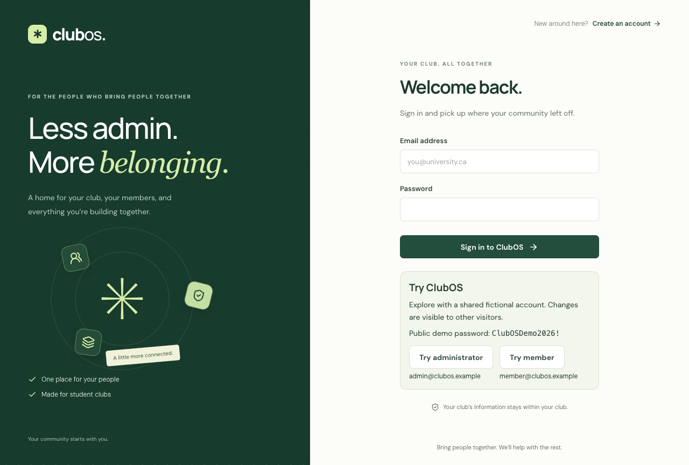

# Validation evidence

## October 30, 2026 — local validation

All checks use disposable data. No real membership database was reset or seeded during verification.

| Area | Verification |
| --- | --- |
| Accounts and sessions | Registration, login/logout, profile updates, persisted sessions, request origins, and cookie safeguards |
| Organization isolation | Administrator/member restrictions and attempts to read or write another club's records |
| Memberships and money | Pending/active/expired boundaries, full payments, early/expired renewals, duplicate/concurrent submissions, history, and changed-fee renewals |
| Fee editing | Administrator-only updates, integer CAD bounds, stale concurrent edits, retained form input, shared club state, unchanged historical amounts/validity |
| Events | Duplicate registration, last-place concurrency, cancellation, repeated check-in, and cancellation/check-in races |
| Notifications | Mocked demo recipient, successful provider response, timeout/failure persistence, no duplicate payment resend, and credential-free public configuration |
| Demo records | Dedicated database guard, useful scenarios, non-destructive reruns with unchanged timestamps, unchanged passwords, and reserved-address collision rejection |
| UI | Loading/empty/failure states, form labels, account redirects, mobile overflow, keyboard focus containment, Escape, direct routes, and unknown routes |

**Component/API result:** 59 tests passed (17 frontend and 42 backend).

`npm run check` runs lint, TypeScript, component/API tests, production compilation, and compiled-server smoke checks. `PLAYWRIGHT_FIREFOX=1 npm run test:browser` additionally runs Chrome and Firefox acceptance scenarios. Install the browser binaries first as described in README.

**Browser result:** six scenarios passed, three each in installed Chrome and Firefox. The full two-account workflow records an initial CAD 20 payment, changes the fee to CAD 25.50, renews at the new amount, and verifies CAD 45.50 received while preserving the original payment. It also exercises registration/cancellation, check-in, member restrictions, and dashboard totals. Separate checks cover seeded logins, mobile keyboard navigation, error recovery, and unknown routes.

Screenshots are actual browser captures:

- [Administrator overview](screenshots/club-workflows-dashboard.png)
- [Event participants](screenshots/club-workflows-event.png)
- [Member attendance on mobile](screenshots/club-workflows-mobile.png)
- [Fee settings on desktop](screenshots/club-settings-desktop.png)
- [Fee settings on mobile](screenshots/club-settings-mobile.png)

GitHub Actions runs the same checks plus Chromium/Firefox acceptance and retains browser reports/traces as artifacts. Local installed Chrome verification complements CI's Chromium engine run.

## Acceptance still requiring connected accounts

Live hosting, Atlas network/credential configuration, and real demo-inbox delivery have not been verified. Local provider mocks prove application behavior, not delivery to a real inbox. Complete the live workflow in the deployment and submission guides after connecting hosting/email services. Do not represent these pending checks as passed.

## Production checks

The compiled-server smoke test covers the full manual-payment/fee/event workflow with production settings, scoped cleanup, and secure-cookie checks. The public `verify:live` command checks readiness without writes. `test:live` runs the two-account browser workflows against an explicitly provided HTTPS origin and creates fictional records; it never reuses local seeded credentials. At the initial validation milestone no public service URL was configured. The October 31 entry and current Render guide describe the supplied live URL and subsequent verification.

## October 31, 2026 — Render public demo

- 68 component/API tests passed (19 frontend and 49 backend), including Render URL/port settings, explicit demo opt-out, reserved-account password synchronization, and public credential discovery through the normal login flow.
- Eight scenarios passed across installed Chrome and Firefox, including public administrator/member login and responsive credential controls.
- The compiled Render-style process starts with a disposable `ClubOS-DB`, seeds before accepting requests, preserves Mongo-backed sessions across a real process restart, restores only reserved demo passwords, and preserves ordinary accounts and edited fees/history.
- The configured Atlas database was seeded/synchronized explicitly with the public demo password; no club records were reset. The service URL is `https://andreys-club-os.onrender.com`. Live deployment verification follows publication; the initial public health requests timed out.
- Real Resend inbox delivery is still separate from application/provider-mock verification.

### October 31 — hosted verification and diagnostic follow-up

After Render's private session secret and Atlas network-access entries were configured, live health, public administrator/member login, secure cookies/logout, seeded membership/history, and the deployed frontend passed verification. The diagnostic follow-up adds seven failure-path tests (75 component/API tests total) and retains passing production/startup-restart smoke checks. Browser behavior is unchanged from the eight verified Chrome/Firefox scenarios. Actual hosted Chrome checks also passed administrator settings and mobile member history without runtime errors or horizontal overflow. Actual Resend inbox delivery remains separate.

## Version 1 dashboard and navigation

The v1 browser suite passes ten scenarios across installed Chrome and Firefox. The new scenario verifies six/twelve-month chart controls, attendance/payment selection, monthly data tables, actual event capacity, author/year/profile footer credits, zero-data club views, and complete long club names on desktop and mobile. It also checks keyboard Escape/focus restoration and horizontal overflow.

The analytics integration tests cover Eastern-time month boundaries, prior-window membership baselines, zero-filled months, chronological event limits, and organization isolation. Current membership status is a snapshot; the member-growth line shows cumulative joined records, not historical active status.

- [Desktop dashboard](screenshots/v1-dashboard-desktop.png)
- [Mobile dashboard](screenshots/v1-dashboard-mobile.png)
- [Mobile sidebar with a long club name](screenshots/v1-sidebar-mobile.png)

**V1 release checks:** 79 component/API tests (21 frontend and 58 backend) pass, together with compilation and both production/startup-restart smoke checks. All ten browser scenarios pass in Chrome and Firefox. Every implementation checkpoint was verified from a separate prospective-commit snapshot, with the existing staged LICENSE and documentation edits kept separate.
